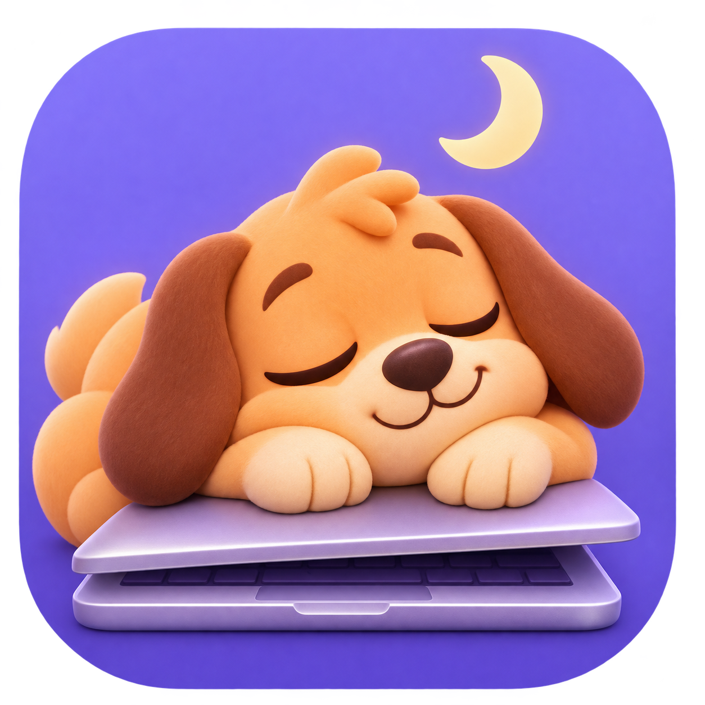

<p align="center">
  
</p>

<h1 align="center">Sleepy Paws</h1>

<p align="center">
  <b>A gentle screen-time limit for kids on the Mac.</b><br>
  When the time is up, a sleepy puppy yawns, the music stops, and the Mac takes a nap.
</p>

<p align="center">
  macOS 12+ · Apple silicon · runs entirely on your Mac · no accounts, no servers, no analytics
</p>

---

## Why

"Five more minutes" is a whole negotiation. Sleepy Paws takes it off your
plate: it's a small menu bar timer with a daily allowance, and when the
allowance runs out a friendly break screen covers every display until a
grown-up says otherwise. No lectures, just a yawning puppy.

## What it does

- 🌙 **Counts down in the menu bar.** It only counts while the Mac is really in
  use: it pauses while the lid is closed, the display is asleep, or the session
  is locked. The allowance resets at midnight.
- 🐶 **Puts up a break screen.** Every display, every Space, over full-screen
  apps, with a little yawn. The Dock, the menu bar, the app switcher and Force
  Quit are off while it's up.
- 🔇 **Stops the noise.** It pauses whatever owns Now Playing (YouTube in any
  browser, Music, Spotify…), pauses Music, Spotify, TV, QuickTime and VLC
  directly, and keeps the Mac muted until the break ends. Volume keys don't
  help, and the sound comes back afterwards.
- 🔑 **Listens to grown-ups.** The four-digit parent PIN adds time (5 minutes
  to 8 hours, the last choice is remembered) or pauses the timer until
  midnight, from the break screen or the menu bar. A wrong PIN shakes the cells
  and says how many tries are left before a 30-second wait.
- 🧑‍💻 **Forgives forgetful parents.** *Forgot PIN?* asks macOS for an
  administrator's name and password instead. Kids on a standard account don't
  have them.
- 🔄 **Keeps itself up to date** with Sparkle, from GitHub Releases.
- 🛡️ **Is hard to wriggle out of.** It starts at login and comes back within
  seconds if it is killed. Progress is saved every few seconds and at shutdown,
  so a restart picks up where it left off. Its state is kept in two copies and
  the stricter one wins, so deleting or editing a file doesn't reset the day.

## Getting started

1. Download the latest ZIP from
   [Releases](https://github.com/design-ninja/sleepy-paws/releases), unzip it
   and move **Sleepy Paws** to /Applications, then open it **in the child's
   standard macOS account**. (Or build it yourself, see below.)
2. Create a parent PIN. The timer starts with a 1-hour daily limit.
3. Change the limit any time in **Settings…** from the menu bar. Saving starts
   today's countdown over from the new limit.

The first time a parent enters the PIN while a music or video app is running,
macOS asks whether Sleepy Paws may control it. Click **Allow**, so it can pause
that app at break time.

## Building

You need Xcode 15 or later.

```bash
./script/build_and_run.sh
```

That builds a debug app into `dist/`, signs it (with your Apple Development
identity when there is one), and starts it as the background agent. Other
useful bits:

```bash
swift test                               # timer, PIN and pause logic
./script/build_and_run.sh --package      # arm64 release build in dist/Release
./script/notarize.sh                     # signed, notarized, stapled ZIP
```

`--package` signs with `SLEEPYPAWS_SIGNING_IDENTITY` (a Developer ID
Application identity) when it's set. `notarize.sh` also needs notary
credentials: `SLEEPYPAWS_NOTARY_PROFILE` (a saved `notarytool` profile) or an
App Store Connect API key in `APP_STORE_KEY_ID`, `APP_STORE_ISSUER_ID` and
`APP_STORE_KEY_PATH`.

### Releasing

Updates reach people through [Sparkle](https://sparkle-project.org): the app
checks `releases/latest/download/appcast.xml` once a day. To ship a version,
bump `CFBundleShortVersionString` and `CFBundleVersion` in
`Resources/Info.plist`, add its section to `CHANGELOG.md`, commit, and run:

```bash
./script/release.sh
```

It notarizes the app, signs the ZIP with the Sparkle EdDSA key from your
keychain (`generate_keys --account sleepy-paws` creates it), writes the
appcast, tags the version and publishes a GitHub release with both files.

## How it stays on

| Kid tries… | Sleepy Paws |
| --- | --- |
| Quitting it | Quit needs the PIN. |
| `killall` / Activity Monitor | A launch agent (`KeepAlive`) brings it back in about two seconds. |
| Restarting or shutting down | It opens at login and continues from the saved progress. |
| Deleting or editing its saved state | A second copy is kept; the stricter one wins. |
| Cmd-Tab, Force Quit, the Dock | Disabled while the break screen is up. |
| Turning the volume back up | Muted again within a quarter of a second. |
| Guessing the PIN | Five tries, then a 30-second wait. The PIN is stored as a salted PBKDF2 hash. |

### What it can't stop

Sleepy Paws is an app in the child's own account, not a system extension.
Keep the child on a **standard (non-admin) account**: such an account can't
change the clock or remove apps from /Applications. Someone determined with
Terminal can still delete both copies of the state (the next launch then asks
for a new PIN) or switch the background item off in Login Items.

For a system-level backstop, also turn on
[Screen Time in the child's account](https://support.apple.com/guide/mac-help/mchlc5595037/mac)
with its own passcode (no Family Sharing needed for local setup): choose
**All Apps & Categories** and **Block at end of limit** where App Limits
exist, or a daily allowance where Time Allowances do.

## Under the hood

- SwiftUI and AppKit, Swift Package Manager; the only dependency is Sparkle.
- `SleepyPawsCore` holds the logic with tests: the daily budget, pauses, PIN
  hashing and attempts, durations.
- Pausing the Now Playing app uses the private MediaRemote framework, loaded at
  run time; if it isn't available, the mute still does the job.
- The yawn is synthesised by `script/make_sound.py`.

See [CHANGELOG.md](CHANGELOG.md) for what changed.

## License

[MIT](LICENSE) © 2026 lirik. That covers the code, the icon and the sound.
